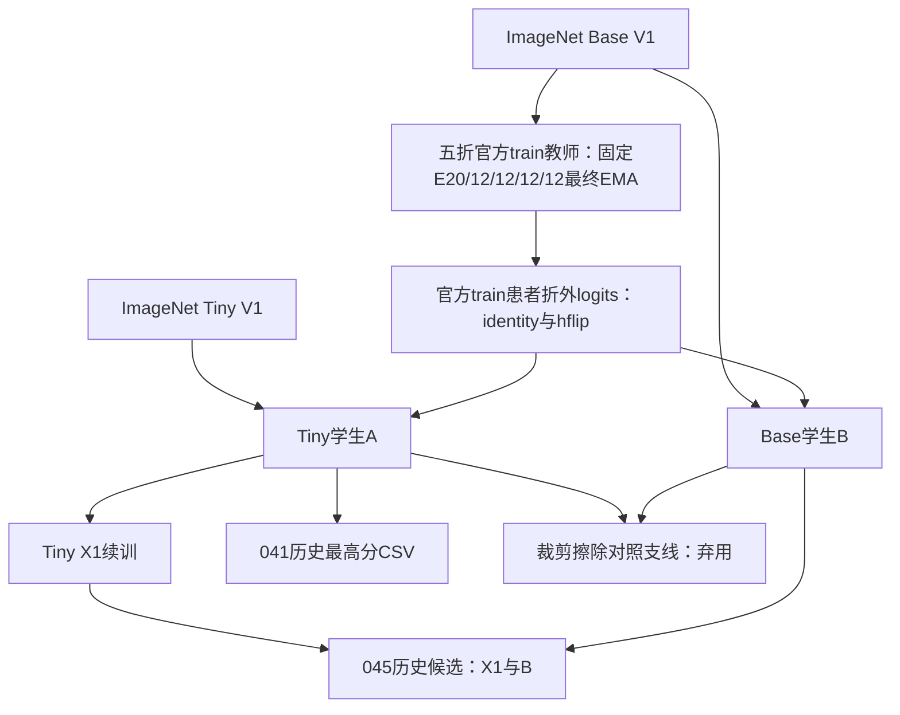

# 当前 V1 血缘与软标签说明

本包只申报通用自然图像预训练的 ConvNeXt V1 链路。五折教师 checkpoint 实算SHA见 evidence/weights/inventory.md，选择依据逐行证据见 evidence/teachers/SELECTION_EVIDENCE.md。

教师只读取相应4折训练患者，held-out患者不用于梯度或epoch选择；best.pt文件名实际代表预先固定轮数结束的EMA，不代表验证AUC最佳。fold0为20轮，其余12轮。教师选择不使用held-out标签，所以患者折外预测隔离的声明有证据；不把学生使用官方valid早停写成教师外折选模。

每图由未见过该患者的教师预测两视图raw logits；缓存仅train，不含valid/test，也不跨Study合并。学生将教师正类权重对齐并按T=2转换后，对两视图sigmoid概率取均值作为软目标；KL采用Bernoulli KL及T²缩放，硬损失系数为(1-alpha)，KD系数为alpha；warmup期间随alpha变化，alpha到0.2后才为0.8/0.2。KD alpha曲线逐权重列于evidence/training/WARMUP_BY_WEIGHT.md。

初始Tiny A使用逐图hard BCE，并按Study图数给予权重；Base B与后续X1/裁剪对照使用完整Study均值概率hard BCE。不能将所有学生训练损失一概写为Study均值概率BCE。原配置和源码位于evidence/training/student_A、student_B等目录。

教师LR warmup1，无KD；初始A/B学生LR warmup1、KD warmup2；X1和裁剪支线LR warmup1、KD warmup0，首轮alpha=.20。训练seed分别见逐权重表，不能以推理seed43替代所有训练seed。推理导出FP16；教师软标签提取BF16、缓存FP32属于训练目标生成阶段，不能与最终推理A6混淆。

V2历史分支未进入上述图，隔离证据见evidence/legacy/README.md。最终C区成员未冻结，不将图中041或045擅自指定为最终提交模型。
