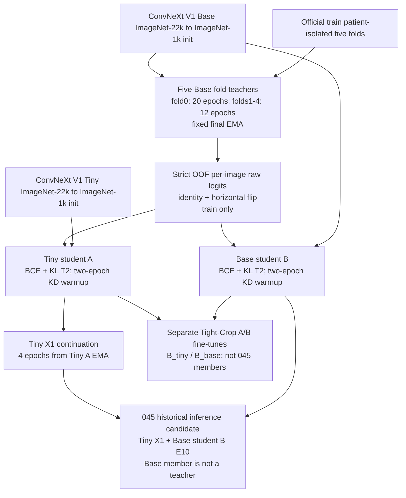

# 申报第一批材料草稿（内部审阅）

状态：供 REVIEW-1 核对。此稿只整理不随最终权重变化的来源、许可、脚本、软标签方法和血缘；不是已提交申报材料。

本稿没有填写任何权重 SHA-256，没有编辑《模型核验材料与数据声明清单.xlsx》，没有修改旧 ZIP，没有上传或申报。最终推理成员和权重冻结后再补第二批材料。

## 规则依据

核对的本地正式文本：

- `artifacts/kd_v1/compliance_repair_20261025/rules/official_rules.pdf` 及其文本提取 `official_rules_extracted.txt`。
- `artifacts/kd_v1/submission_rules_recheck_20261028/supplement_20261027.pdf`；规则来源与适用顺序另见 `docs/COMPETITION_RULES.md`、`docs/OFFICIAL_RULES_CHECKLIST.md`。
- 蒸馏申报细则还在 `artifacts/kd_v1/student_takeover_20261030/rules_1.pdf.txt` 的正式补充说明第三节第（五）项复核。

规则第 10 条要求提交材料可复现，并随提交提供第 1 条所需的开源模型材料。第 11 条规定材料不实或遗漏须补正，逾期不补正会导致成绩不予认定；伪造材料、测试集泄漏或隐瞒医学预训练属于严重违规。附录 A 要求模型核验清单及材料包，A1–A6 分别覆盖模型名称、公开权重链接、许可证全文、上游训练数据说明、预训练权重 SHA-256、推理精度。正式补充第三节第（五）项进一步要求如实申报教师与学生的来源、许可证、哈希、蒸馏关系、脚本和软标签生成方式；教师不参与推理时仍须申报教师哈希和许可证。

## 预训练来源与许可证

两种骨干均为 ConvNeXt V1 的通用自然图像预训练权重，记录的预训练数据为 ImageNet-22k，随后在 ImageNet-1k 微调。当前材料记录未使用医学影像预训练权重。

| 用途 | 模型及固定来源 | 上游数据说明 | 许可证记录 |
|---|---|---|---|
| 五折教师、Base 学生 | `timm/convnext_base.fb_in22k_ft_in1k_384`。权重：[固定 revision 下载链接](https://huggingface.co/timm/convnext_base.fb_in22k_ft_in1k_384/resolve/2b2698d86523262ca8065d0957c7f80d963bb43f/model.safetensors)；model card：[固定 revision README](https://huggingface.co/timm/convnext_base.fb_in22k_ft_in1k_384/raw/2b2698d86523262ca8065d0957c7f80d963bb43f/README.md)。 | ImageNet-22k 预训练、ImageNet-1k 微调；model card 写明 ConvNeXt V1。 | 模型卡元数据记录 `Apache-2.0`；完整文本来自 `https://www.apache.org/licenses/LICENSE-2.0.txt`。上游 ConvNeXt 代码另记录 MIT `LICENSE`，来源 `https://raw.githubusercontent.com/facebookresearch/ConvNeXt/main/LICENSE`。本地完整文本位置见下表。 |
| Tiny 学生 | `timm/convnext_tiny.fb_in22k_ft_in1k_384`。权重：[固定 revision 下载链接](https://huggingface.co/timm/convnext_tiny.fb_in22k_ft_in1k_384/resolve/32c741ba106f9e062174ef829354a16719c3dcac/model.safetensors)；model card：[固定 revision README](https://huggingface.co/timm/convnext_tiny.fb_in22k_ft_in1k_384/raw/32c741ba106f9e062174ef829354a16719c3dcac/README.md)。 | ImageNet-22k 预训练、ImageNet-1k 微调；model card 写明 ConvNeXt V1。 | 同上：模型卡登记 Apache-2.0，ConvNeXt 上游仓库登记 MIT `LICENSE`。最终材料包应保留适用于实际权重及代码的完整许可证原文。 |

本地 provenance 记录与全文位置：

- Base：`artifacts/kd_v1/environment_repair_20261025/convnext_base_pretrained_provenance.json`。其中 `materials.model_card.text` 保存模型卡全文，`materials.apache_license.text` 保存 Apache License 2.0 全文，`materials.upstream_license.text` 保存 ConvNeXt MIT License 全文。
- Tiny：`artifacts/kd_v1/environment_repair_20261025/convnext_tiny_pretrained_provenance.json`，同样保存上述三段完整文本。
- 当前没有发现独立的 `licenses/` 目录或许可证 `.txt` 文件；完整文本存在于 provenance JSON。附录 A 的最终包结构列有 `licenses/`，故冻结材料包时应将经审核的完整原文分别作为可读文件放入该目录。这里不复制或改写既有许可文本。

许可审阅点：模型卡登记 Apache-2.0，ConvNeXt 上游代码仓库登记 MIT。草稿保留两份来源记录，不把其中一份静默替代另一份；请在 REVIEW-1 确认最终包中需随权重提供的许可文件范围。

## 实际训练和提取程序

| 阶段 | 实际程序及配置证据 | 已核实事实 |
|---|---|---|
| 五折 Base 教师 | 程序：`run_mixed_teachers.py`、`train_teacher.py`。教师集合：`/home/featurize/work/runs/024_convnext_v1_base768_mixed20_12_cv5/teacher_collection.json`。fold 0 配置：`/home/featurize/work/runs/021_convnext_v1_base768_teacher_cv5/fold_0/config.json`；fold 1–4 配置分别在 `/home/featurize/work/runs/023_convnext_v1_base768_teacher12_cv5/fold_{1..4}/config.json`。训练证据索引：各 run 下 `evidence/evidence_manifest.json`、实际源码快照和 console log。 | ConvNeXt V1 Base、768 输入、seed 43、固定最终 EMA；fold 0 训练 20 轮，fold 1–4 各 12 轮。按官方 train 患者划分五折；教师输出只作为训练集 OOF 软标签来源，不是 045 部署成员。 |
| OOF 软标签提取 | `extract_soft_labels_tta.py`；数据转换/读取：`distill_tta_data.py`。集合和折计划同上。输出：`/home/featurize/work/runs/024_convnext_v1_base768_mixed20_12_cv5/oof_logits_tta_v2/metadata.json` 与 `soft_labels.npz`。 | metadata 声明 source split 为 train、schema 为 `cxr_strict_oof_view_logits_v2`、30328 张图、每图 identity 与 horizontal-flip 两视图的原始 logits。提取器逐折只预测该折 held-out 患者，并检查折内图像覆盖；不对 logits 先做 sigmoid、温度缩放或类别权重校准。 |
| 初始 Tiny/Base 学生蒸馏 | `train_distill.py`。实际配置：`artifacts/kd_v1/student_upper_bound_20261030/models/A/metadata/config.json`（Tiny）及 `.../models/B/metadata/config.json`（Base）；训练证据在各自 `metadata/evidence/`。 | 两者读取上述严格 OOF 缓存及官方 train 标签。配置为 hard BCE 系数 0.8、Bernoulli KL 系数 0.2、温度 2、前两轮渐进增加 KD 权重、EMA decay 0.999；最大 25 轮、patience 5、min_delta 0.0001。使用 Study 等权损失；官方 valid 仅用于检查点选择/早停，test 未用于训练或拟合。 |
| 045 历史候选的微调与成员组成 | 微调程序：`run_bounded_pipeline.py` / `train_distill.py`。Tiny X1 配置：`artifacts/kd_v1/bounded_finetune_20261101/training/X1/config.json`。成员和选取记录：`deliveries/045_X1_B_best817149_submission_20261101/SELECTION_BEFORE_TEST.json`、`.../model/config.json`、`.../README.md`。 | 045 的 Tiny X1 从已蒸馏 Tiny 学生 A 的 EMA 初始化后继续训练 4 轮；Base B 成员是已蒸馏的 Base 学生 B（E10），不是五折教师。045 是历史候选，不据此表示 v2.2 下最终权重已冻结。 |
| 近期 Tight-Crop A/B 支线（非 045 成员） | `tight_crop_ab_earlystop_training.py`；实际运行配置在 `artifacts/tight_crop_ab_20261102/earlystop25/runs/B_tiny/config.json`、`.../B_base/config.json`，日志在各自 `evidence/`。 | 这是从既有 Tiny/Base 蒸馏学生 EMA 初始化的独立裁剪/擦除实验分支，不可把其 B_tiny 或 B_base 与 045 中的历史 Base 学生 B 混为一谈。此支线的 KD 权重未渐进（偏差详见下一节）。 |

## 软标签生成说明

1. 固定五折计划按 `Subject_id` 隔离患者。每张 train 图只由其患者所在 held-out fold 对应、训练时未见该患者的 Base 教师预测。教师集合在 `teacher_collection.json` 中逐折声明；`extract_soft_labels_tta.py` 会验证每折 checkpoint 与 fold plan 的绑定，并验证 held-out 图像覆盖。
2. 对每张图固定前向 identity 与 horizontal flip 两个视图，缓存每类 raw logits。软标签是逐图目标，提取时不把同患者的不同 Study 合并，也不把 Study 标签复制成另一种预测单位。
3. 训练读取缓存时，以教师正类权重对齐和温度 `T=2` 转换两视图 logits，再取 sigmoid 概率均值形成软目标。学生硬标签损失按完整 Study 处理；Study 内图像概率均值后与 Study 标签计算 hard BCE，软损失按 Study 等权汇总。损失在十类维度取均值，组合为 `0.8 * hard_BCE + 0.2 * KL_T2`。
4. 上述初始学生训练的 KD 系数在前两轮渐进增加，之后固定；推理的 `hflip2` 是独立固定推理设置，不是软标签缓存生成时的训练增强。

核对依据：`extract_soft_labels_tta.py` 的 held-out fold 循环；`distill_tta_data.py` 的 raw-view-logit 读取与目标构造；`train_distill.py` 的 `distillation_protocol`、`alpha_at`、损失和 Study 聚合实现；初始 A/B 学生 `config.json` 与 OOF metadata。当前草稿不附带任何权重哈希值。

## 血缘图

## 执行单与实测偏差（REVIEW-1）

- **教师/学生身份**：符合 v2.1 勘误。五折 Base 是离线教师，仅用于严格 OOF 软标签；045 中 Base768 成员是蒸馏 Base 学生 B 的 E10 检查点，不是五折教师。
- **初始学生 KD 配方**：A/B 初始学生配置记录 `alpha=0.2`、`temperature=2`、`kd_warmup_epochs=2`，与执行单写的 BCE 0.8 + KL 0.2、T=2、前两轮渐进相符。
- **本轮续训不是同一 warmup 配置**：045 的 Tiny X1 续训配置 `artifacts/kd_v1/bounded_finetune_20261101/training/X1/config.json` 记录 `kd_warmup_epochs=0`；当前 Tight-Crop A/B 的 B_tiny、B_base top-level 实际配置分别在 `artifacts/tight_crop_ab_20261102/earlystop25/runs/B_tiny/config.json` 与 `.../B_base/config.json`，该字段也均为 `0`。B_tiny 日志 `.../B_tiny/evidence/console_20261102T024037Z_61c80be4.log` 第 1 轮已打印 `alpha=0.2000`；训练器 `tight_crop_ab_earlystop_training.py` 校验也强制 `kd_warmup_epochs=0`。因此这些续训从第 1 轮使用完整 0.2 KD 系数，没有两轮渐进。各配置中 nested `source_distillation` 的 `warmup_epochs=2` 描述初始化学生的历史训练，不是本轮续训值。
- **与申报的关系**：上面是实际训练血缘和配方披露，必须避免把历史初始 KD 配方误说成每次续训都使用。若申报只描述 045 成员，应分别写 Base B 的初始 KD 与 Tiny X1 的续训配置；若需要披露 Tight-Crop A/B，应明确其训练支线 warmup 为 0 且不是 045 成员。
- **最终模型尚待冻结**：045 只能作为历史候选引用；v2.2 后续最终推理成员可能改变，最终成员表、逐权重 SHA、体积及推理精度要在第二批按实际冻结文件填写。
- **许可文件交付形态**：本地 provenance JSON 含完整许可证文字，但尚无 Appendix A 所示独立 `licenses/` 文件夹。这是打包缺口，不是许可证内容缺失；待 REVIEW-1 确认文件范围后再为最终包生成规范文本文件。

## REVIEW-1 待确认

- 两份已存的 Apache-2.0 与 MIT 原文应如何分装到最终 `licenses/`，以及最终采用的许可证说明口径。
- 最终申报清单应包含 045 历史候选、后续替换的实际成员，还是只申报最终被冻结的推理成员与其离线教师血缘。
- 确认上述 warmup 差异按阶段拆开披露，避免把 `kd_warmup_epochs=2` 套用到 X1 或 Tight-Crop A/B 续训。

本稿到 REVIEW-1 为止；没有创建申报 XLSX、申报 ZIP、许可证副本或平台提交记录。
