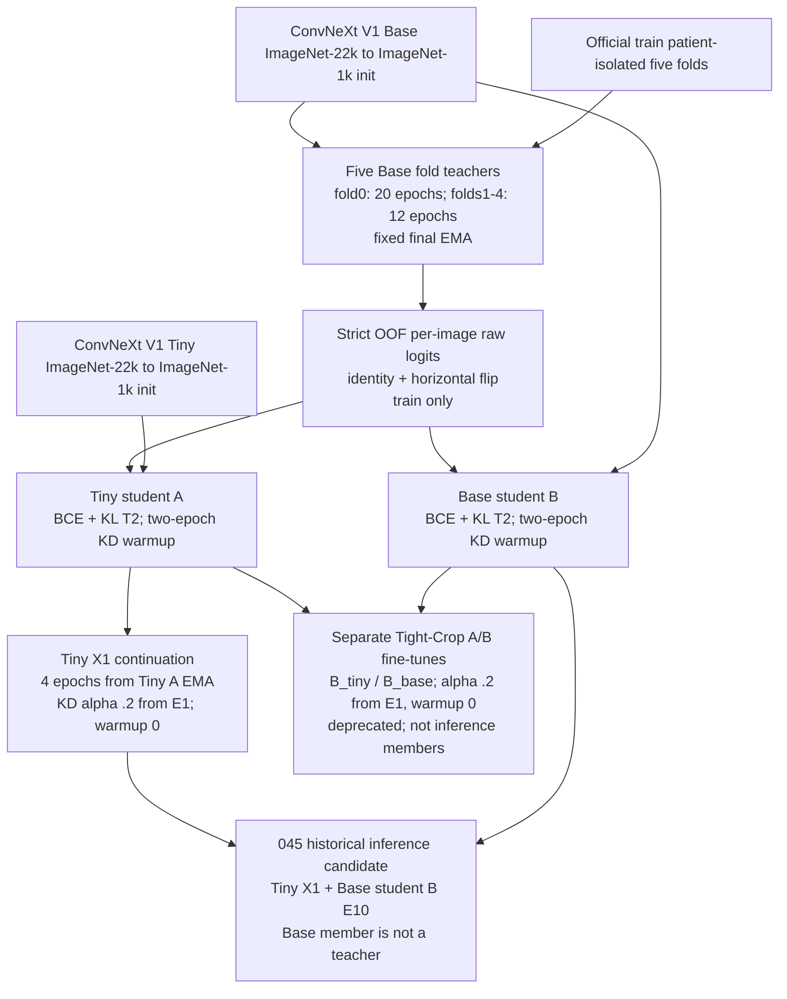

# 申报第一批材料草稿（内部审阅）

状态：供 REVIEW-1 核对。此稿只整理不随最终权重变化的来源、许可、脚本、软标签方法和血缘；不是已提交申报材料。

本稿没有填写训练产物/推理权重 SHA-256，没有修改旧 ZIP，没有上传或申报。服务器上未找到独立的现行《模型核验材料与数据声明清单.xlsx》模板；旧交付包 `/home/featurize/work/deliveries/038_dual768_optimized_project_20261030.zip` 内含一份已填写的旧版清单，SHA-256 为 `d3d53e95cadc215fe99b81cedc2e6519e1e2eca09c58bcd72e3453bb01f7025a`。尚未核实它与当前官方模板是否同版，因此本稿暂不判断能否直接复用。现已依据038旧表另建内部草案 `artifacts/new_study_cost_20261102/申报材料第一批_A-B草案_依据038旧表.xlsx`，并附自查表；模板版本待 REVIEW-1 核验，C 节只标“待最终权重冻结”。

## 规则依据

核对的本地正式文本：

- `artifacts/kd_v1/compliance_repair_20261025/rules/official_rules.pdf` 及其文本提取 `official_rules_extracted.txt`。
- `artifacts/kd_v1/submission_rules_recheck_20261028/supplement_20261027.pdf`；规则来源与适用顺序另见 `docs/COMPETITION_RULES.md`、`docs/OFFICIAL_RULES_CHECKLIST.md`。
- 蒸馏申报细则还在 `artifacts/kd_v1/student_takeover_20261030/rules_1.pdf.txt` 的正式补充说明第三节第（五）项复核。

规则第 10 条要求提交材料可复现，并随提交提供第 1 条所需的开源模型材料。第 11 条规定材料不实或遗漏须补正，逾期不补正会导致成绩不予认定；伪造材料、测试集泄漏或隐瞒医学预训练属于严重违规。附录 A 要求模型核验清单及材料包，A1–A6 分别覆盖模型名称、公开权重链接、许可证全文、上游训练数据说明、预训练权重 SHA-256、推理精度。正式补充第三节第（五）项进一步要求如实申报教师与学生的来源、许可证、哈希、蒸馏关系、脚本和软标签生成方式；教师不参与推理时仍须申报教师哈希和许可证。

## 预训练来源与许可证

两种骨干均为 ConvNeXt V1 的通用自然图像预训练权重，记录的预训练数据为 ImageNet-22k，随后在 ImageNet-1k 微调。当前材料记录未使用医学影像预训练权重。

| 用途 | 模型及固定来源 | 上游数据说明 | 许可证记录 |
|---|---|---|---|
| 五折教师、Base 学生 | `timm/convnext_base.fb_in22k_ft_in1k_384`。权重：[固定 revision 下载链接](https://huggingface.co/timm/convnext_base.fb_in22k_ft_in1k_384/resolve/2b2698d86523262ca8065d0957c7f80d963bb43f/model.safetensors)；model card：[固定 revision README](https://huggingface.co/timm/convnext_base.fb_in22k_ft_in1k_384/raw/2b2698d86523262ca8065d0957c7f80d963bb43f/README.md)。 | ImageNet-22k 预训练、ImageNet-1k 微调；model card 写明 ConvNeXt V1。 | 模型卡元数据记录 `Apache-2.0`；完整文本来自 `https://www.apache.org/licenses/LICENSE-2.0.txt`。上游 ConvNeXt 代码另记录 MIT `LICENSE`，来源 `https://raw.githubusercontent.com/facebookresearch/ConvNeXt/main/LICENSE`。本地完整文本位置见下表。 |
| Tiny 学生 | `timm/convnext_tiny.fb_in22k_ft_in1k_384`。权重：[固定 revision 下载链接](https://huggingface.co/timm/convnext_tiny.fb_in22k_ft_in1k_384/resolve/32c741ba106f9e062174ef829354a16719c3dcac/model.safetensors)；model card：[固定 revision README](https://huggingface.co/timm/convnext_tiny.fb_in22k_ft_in1k_384/raw/32c741ba106f9e062174ef829354a16719c3dcac/README.md)。 | ImageNet-22k 预训练、ImageNet-1k 微调；model card 写明 ConvNeXt V1。 | 同上：模型卡登记 Apache-2.0，ConvNeXt 上游仓库登记 MIT `LICENSE`。最终材料包应保留适用于实际权重及代码的完整许可证原文。 |

本地 provenance 记录与可读材料位置：

- Base：`artifacts/kd_v1/environment_repair_20261025/convnext_base_pretrained_provenance.json`。其中 `materials.model_card.text` 保存模型卡全文，`materials.apache_license.text` 保存 Apache License 2.0 全文，`materials.upstream_license.text` 保存 ConvNeXt MIT License 全文。
- Tiny：`artifacts/kd_v1/environment_repair_20261025/convnext_tiny_pretrained_provenance.json`，同样保存上述三段完整文本。
- 独立可读副本已放入 `licenses/convnext_base/`、`licenses/convnext_tiny/`；逐文件 SHA-256 与来源 URL 见 `licenses/README.md`。每个模型目录均含完整 Apache-2.0 原文和固定 revision 的 HF model card 快照；ConvNeXt 上游 MIT 原文单列于 `licenses/convnext_upstream/`。
- 当前本地归档的许可材料中未见单独 NOTICE 文件。HF API 请求返回 HTTP 429，远端模型仓库文件清单及是否包含 NOTICE 均未核实；本地归档未见 NOTICE 不代表上游仓库没有 NOTICE。待 API 可访问后再核对远端文件列表。

许可口径：每个 Hugging Face 模型分别申报 Apache-2.0，并同时保留其固定 revision 的模型卡；ConvNeXt 上游代码 MIT 许可作为额外来源材料附上。远端文件列表核验仍待完成，当前不能确认上游是否另有 NOTICE。

## 实际训练和提取程序

| 阶段 | 实际程序及配置证据 | 已核实事实 |
|---|---|---|
| 五折 Base 教师 | 程序：`run_mixed_teachers.py`、`train_teacher.py`。教师集合：`/home/featurize/work/runs/024_convnext_v1_base768_mixed20_12_cv5/teacher_collection.json`。fold 0 配置：`/home/featurize/work/runs/021_convnext_v1_base768_teacher_cv5/fold_0/config.json`；fold 1–4 配置分别在 `/home/featurize/work/runs/023_convnext_v1_base768_teacher12_cv5/fold_{1..4}/config.json`。训练证据索引：各 run 下 `evidence/evidence_manifest.json`、实际源码快照和 console log。 | ConvNeXt V1 Base、768 输入、seed 43、固定最终 EMA；fold 0 训练 20 轮，fold 1–4 各 12 轮。按官方 train 患者划分五折；教师输出只作为训练集 OOF 软标签来源，不是 045 部署成员。 |
| OOF 软标签提取 | `extract_soft_labels_tta.py`；数据转换/读取：`distill_tta_data.py`。集合和折计划同上。输出：`/home/featurize/work/runs/024_convnext_v1_base768_mixed20_12_cv5/oof_logits_tta_v2/metadata.json` 与 `soft_labels.npz`。 | metadata 声明 source split 为 train、schema 为 `cxr_strict_oof_view_logits_v2`、30328 张图、每图 identity 与 horizontal-flip 两视图的原始 logits。提取器逐折只预测该折 held-out 患者，并检查折内图像覆盖；不对 logits 先做 sigmoid、温度缩放或类别权重校准。 |
| 初始 Tiny 学生 A | `train_distill.py`；`artifacts/kd_v1/student_upper_bound_20261030/models/A/metadata/config.json`；日志 `.../metadata/evidence/console_20261030T052954Z_dc99f91e.log`。 | 使用 OOF 软标签；hard BCE 系数 0.8、KL 系数 `alpha=0.2`、`T=2`；KD alpha 在前两轮从 0 线性渐进到 0.2；从 Tiny ImageNet 预训练权重开始，EMA decay 0.999。 |
| 初始 Base 学生 B | `train_distill.py`；`artifacts/kd_v1/student_upper_bound_20261030/models/B/metadata/config.json`；日志 `artifacts/kd_v1/student_upper_bound_20261030/B.training.log` 与 `.../metadata/evidence/console_20261030T103505Z_a5480d3c.log`。 | 使用 OOF 软标签；hard BCE 系数 0.8、KL 系数 `alpha=0.2`、`T=2`；KD alpha 在前两轮从 0 线性渐进到 0.2；从 Base ImageNet 预训练权重开始，EMA decay 0.999。 |
| 045 历史候选的微调与成员组成 | 微调程序：`run_bounded_pipeline.py` / `train_distill.py`。Tiny X1 配置：`artifacts/kd_v1/bounded_finetune_20261101/training/X1/config.json`。成员和选取记录：`deliveries/045_X1_B_best817149_submission_20261101/SELECTION_BEFORE_TEST.json`、`.../model/config.json`、`.../README.md`。 | 045 的 Tiny X1 从已蒸馏 Tiny 学生 A 的 EMA 初始化后继续训练 4 轮；Base B 成员是已蒸馏的 Base 学生 B（E10），不是五折教师。045 是历史候选，不据此表示 v2.2 下最终权重已冻结。 |
| 近期 Tight-Crop B_tiny / B_base（弃用候选） | `tight_crop_ab_earlystop_training.py`；配置与逐权重日志见 `artifacts/tight_crop_ab_20261102/earlystop25/runs/{B_tiny,B_base}/`。 | 两者各自读取 OOF 软标签、`alpha=0.2` 固定从 E1 生效、warmup 0；分别从已有 Tiny A / Base B EMA 开始。它们是弃用实验产物，不是 045 成员，也不得写入最终推理成员。 |

## 逐权重训练配置台账

| 权重名 | 使用软标签 | alpha 曲线 / KD系数 | 普通 LR warmup epochs | KD warmup epochs | 起点 | 日志证据路径 |
|---|---|---|---:|---:|---|---|
| 五折 Base 教师 fold 0 | 否 | 不适用（监督训练） | 0 | N/A | Base ImageNet-22k→1k 预训练权重 | `/home/featurize/work/runs/021_convnext_v1_base768_teacher_cv5/evidence/console_live.raw.log`；fold配置 `.../fold_0/config.json` |
| 五折 Base 教师 fold 1 | 否 | 不适用（监督训练） | 0 | N/A | Base ImageNet-22k→1k 预训练权重 | `/home/featurize/work/runs/023_convnext_v1_base768_teacher12_cv5/fold_1/history.jsonl`；配置同目录 `config.json` |
| 五折 Base 教师 fold 2 | 否 | 不适用（监督训练） | 0 | N/A | Base ImageNet-22k→1k 预训练权重 | `/home/featurize/work/runs/023_convnext_v1_base768_teacher12_cv5/fold_2/history.jsonl`；配置同目录 `config.json` |
| 五折 Base 教师 fold 3 | 否 | 不适用（监督训练） | 0 | N/A | Base ImageNet-22k→1k 预训练权重 | `/home/featurize/work/runs/023_convnext_v1_base768_teacher12_cv5/fold_3/history.jsonl`；配置同目录 `config.json` |
| 五折 Base 教师 fold 4 | 否 | 不适用（监督训练） | 0 | N/A | Base ImageNet-22k→1k 预训练权重 | `/home/featurize/work/runs/023_convnext_v1_base768_teacher12_cv5/fold_4/history.jsonl`；配置同目录 `config.json` |
| 初始 Tiny 学生 A | 是 | alpha 0→0.2，前两轮线性渐进；hard BCE 0.8 + KL alpha | 1 | 2 | Tiny ImageNet-22k→1k 预训练权重 | `artifacts/kd_v1/student_upper_bound_20261030/models/A/metadata/evidence/console_20261030T052954Z_dc99f91e.log` |
| 初始 Base 学生 B | 是 | alpha 0→0.2，前两轮线性渐进；hard BCE 0.8 + KL alpha | 1 | 2 | Base ImageNet-22k→1k 预训练权重 | `artifacts/kd_v1/student_upper_bound_20261030/models/B/metadata/evidence/console_20261030T103505Z_a5480d3c.log` |
| 045 Tiny X1 续训 | 是 | alpha 固定 0.2；hard BCE 0.8 + KL 0.2 | 1 | 0 | 初始 Tiny 学生 A 的 EMA | `artifacts/kd_v1/bounded_finetune_20261101/training/X1/evidence/console_20261101T065111Z_dd661416.log` |
| Tight-Crop B_tiny（弃用） | 是 | alpha 固定 0.2；hard BCE 0.8 + KL 0.2 | 1 | 0 | Tiny 学生 A 的 EMA | `artifacts/tight_crop_ab_20261102/earlystop25/runs/B_tiny/evidence/console_20261102T024037Z_61c80be4.log`（E1 alpha=0.2000） |
| Tight-Crop B_base（弃用） | 是 | alpha 固定 0.2；hard BCE 0.8 + KL 0.2 | 1 | 0 | Base 学生 B 的 EMA | `artifacts/tight_crop_ab_20261102/earlystop25/runs/B_base/evidence/console_20261102T055123Z_db7ec019.log` |

注：普通 LR warmup 与 KD warmup 是两个独立配置，按运行权重逐行记录；续训不继承初始化模型的 warmup 值。教师没有 KD warmup，记为 N/A；不得把 Tight-Crop 产物写成最终成员。

## 软标签生成说明

1. 固定五折计划按 `Subject_id` 隔离患者。每张 train 图只由其患者所在 held-out fold 对应、训练时未见该患者的 Base 教师预测。教师集合在 `teacher_collection.json` 中逐折声明；`extract_soft_labels_tta.py` 会验证每折 checkpoint 与 fold plan 的绑定，并验证 held-out 图像覆盖。
2. 对每张图固定前向 identity 与 horizontal flip 两个视图，缓存每类 raw logits。软标签是逐图目标，提取时不把同患者的不同 Study 合并，也不把 Study 标签复制成另一种预测单位。
3. 训练读取缓存时，以教师正类权重对齐和温度 `T=2` 转换两视图 logits，再取 sigmoid 概率均值形成软目标。学生硬标签损失按完整 Study 处理；Study 内图像概率均值后与 Study 标签计算 hard BCE，软损失按 Study 等权汇总。损失在十类维度取均值，组合为 `0.8 * hard_BCE + 0.2 * KL_T2`。
4. 上述初始学生训练的 KD 系数在前两轮渐进增加，之后固定；推理的 `hflip2` 是独立固定推理设置，不是软标签缓存生成时的训练增强。

核对依据：`extract_soft_labels_tta.py` 的 held-out fold 循环；`distill_tta_data.py` 的 raw-view-logit 读取与目标构造；`train_distill.py` 的 `distillation_protocol`、`alpha_at`、损失和 Study 聚合实现；初始 A/B 学生 `config.json` 与 OOF metadata。当前草稿不附带任何权重哈希值。

## 血缘图

## 执行单与实测偏差（REVIEW-1）

- **教师/学生身份**：符合 v2.1 勘误。五折 Base 是离线教师，仅用于严格 OOF 软标签；045 中 Base768 成员是蒸馏 Base 学生 B 的 E10 检查点，不是五折教师。
- **逐权重 KD 配置**：见上表；普通 LR warmup 和 KD warmup 分列记录。初始 Tiny/Base 学生 KD warmup 各为 2 轮；045 X1 续训及 B_tiny/B_base KD warmup 为 0 轮，B_tiny E1 日志 alpha=0.20。各 run 的 top-level 配置和对应 console log 是权威证据，nested `source_distillation` 仅描述初始化权重的历史配方。
- **最终模型尚待冻结**：045 只能作为历史候选引用；v2.2 后续最终推理成员可能改变，最终成员表、逐权重 SHA、体积及推理精度要在第二批按实际冻结文件填写。
- **申报 XLSX 文件状态**：未找到独立的现行官方清单模板；038 旧交付 ZIP 内有已填写旧版清单（SHA-256 见文首），当前已据此改制第一批内部 XLSX 草案及自查表。模板版本仍待 REVIEW-1 核验；C 节仅留“待最终权重冻结”。
- **许可证快照状态**：完整许可证和两份固定 revision 模型卡已复制到 `licenses/` 并生成哈希清单；HF API 返回 429，远端文件列表及是否含 NOTICE 尚未核实。

## REVIEW-1 裁定落实情况

- warmup 按权重逐行如实记录，不使用“统一配方”表述。
- Base/Tiny 各自的 Apache-2.0 原文和 HF model card 放入独立目录；上游 MIT 原文作为额外来源材料。
- XLSX 分 A 预训练权重、B 训练产物、C 最终推理成员；第一批草案已建立 A/B 信息，C 仅留“待最终权重冻结”。038 ZIP 中旧版清单已定位，但未核实与现行模板同版。
- Tight-Crop 产物标为弃用，不进入候选最终成员清单；045 仅记作历史候选。

独立第一批 XLSX 草案和自查表已创建；ZIP 未创建，未上传或申报。模板版本待 REVIEW-1 核验；本地许可证副本和来源清单已准备，远端 NOTICE 状态待核实。
