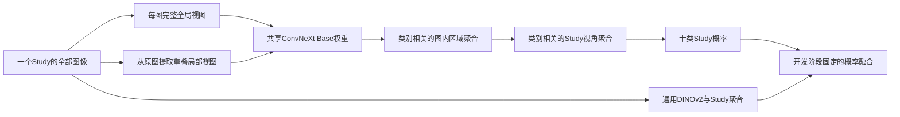

**医学影像比赛：独立审计与重构训练方案**

日期：2026-11-03，Asia/Hong_Kong。开始审计时为`b849ad9`；交付前已纳入另一agent保存暂停进度的最新提交`ed50d71`。本次交付是研究判断与可执行实验设计，没有启动新训练。

**我的首选路线：重新建立患者隔离的研究验证体系，从合规通用预训练重新训练“完整 Study＋全局/局部共享骨干＋类别专属跨视角聚合”，再用一个合规的异构视觉模型提供互补。旧教师蒸馏改为需要证明增益的选项。**

这条路线最值得投入的原因，是它同时针对现有验证可靠性、信息损失和表征同质化三个缺口。它不是已验证的提分承诺；现有资料不足以可靠预测最终能达到0.83、0.85或某个线上名次。

**一、调查范围与最新停止点**

逐页阅读根目录 `rules.pdf`（6页）、`rules_1.pdf`（5页），并采用用户明确更新的“100ms针对每个Study”口径。本轮按用户要求先不以速度筛选算法；实际推理资产≤500MB仍是硬约束。

调查包含当前仓库全部114条提交索引、当前源码和测试的静态索引、历史归档核心源码、41份训练history共317条记录，以及相关原始评估JSON、队列日志和交付记录。核心数据、损失、模型、蒸馏、验证、融合与部署链路进行了人工语义审查；源文件索引不等于逐行形式化验证，旧压缩包里的重复工程未逐份解压重审。

本目录保存了复算脚本、两清单独立统计、220份源文件索引、完整Git提交标题和训练history快照。不会把交接文档中的建议当作新的实验事实；报告引用的历史成绩不是本次重新跑GPU得到的。

另一个agent的最新停止状态已核对：

- 香港时间21:55，`artifacts/resolution_explore_20261103/STOP`、其`queue/STOP`及`roi_queue_20261103/STOP`写入用户要求保存停止的记录。
- 031/032/033三组分辨率训练均完成3轮，best均为E1；E3比较、E1实际FP16重评均完成。
- `artifacts/resolution_e1_analysis_20261103/RESOLUTION_DECISION.md`、`analysis/class14_diagnostic.md`、`analysis/patient_mean_e1.md`是最新分析入口。
- ROI队列目前只有STOP，未发现新的ROI/MIL训练产物；检查时无相关训练进程，2080Ti显存占用1MiB、利用率0%。
- 最新正式交接为`docs/EXPLORATION_PAUSED_HANDOFF_20261103.md`，总状态已保存为`STOPPED_BY_USER`，E1独立分析仍为历史`COMPLETED`，旧失败状态已归档。
- 仓库仍有三个原有未跟踪Python文件；没有将它们删除、接管或纳入本次修改。

旧日志中的FAILED/旧README中的RUNNING不能直接当现状，更不能据此重启旧队列。下一步应创建独立研究工程与run，保留已经完成的实验资产。

**二、规则真正允许的研究空间**

| 问题 | 规则结论及本方案处理 |
|---|---|
| 预训练来源 | 仅通用非医学主数据来源，公开可下载、允许赛事及再分发、非NC、非gated；视觉教师也必须满足 |
| 官方train自监督 | 补充说明第四节明确允许；新内部验证中，SSL也必须排除持出患者，才能声称未见泛化 |
| KD与特征蒸馏 | 允许；不参与最终推理的教师不计500MB，但来源、哈希与关系须申报 |
| 多模型、固定多裁剪/TTA | 允许；不限制一次Study只能做一次前向，也不限制只能Tiny |
| 可学习Study聚合 | 训练阶段学参数、推理冻结，使用同Study图像做固定前向；不进行测试统计拟合或参数更新 |
| valid并训 | 允许，但并入后不能再用其早停、挑checkpoint、调任何参数；不作为当前首选步骤 |
| test | 不用于SSL、KD、伪标签、选模、阈值或先验估计；本次调查不以test预测或分布设计方案 |
| 体积 | 实际调用的去重权重、配置及量化/编译引擎等，解压后合计≤500MB；不能只算ZIP压缩体积 |
| 时限 | 按用户更新为每Study100ms；本轮研究暂不优化速度，不由此声称最终参赛已合规 |

旧执行单的“只能双Tiny”“禁止多分支”“不重训教师”“每项预期必须大于0.005”是历史策略限制，不是上述PDF的算法禁令。它们不应限制这次重构方案。旧执行单把0.003说成普遍统计分辨率也不成立：置信区间取决于比较对象、类别支持和误差相关性。

原PDF SHA256：`ff6aa3adbfd3d000194253055a93dbce8a140031c8432f892046a49de8136fb6`；补充PDF：`836c4f5d3202f2dc65830fd919ca195797c12b7507d750121786a21672dc7a44`。

**三、现在究竟在做什么，哪些进步真实成立**

当前主干谱系是：合规ConvNeXt V1 Base五折教师 → 每图一位患者折外教师的双视图logits → Tiny学生 → 平方根正类权重Tiny A与完整Study损失Base B → 微调、冻结头与Tiny/Base融合 → 三轮分辨率暖启探索。

关键Git锚点：`dd8a915`合规V1基线；`89fb455`纯监督BCE；`bdf0910`平方根权重；`b5a309c`完整Study训练；`0838e4c`EMA暖启；`f5f725f`冻结头；`c10437a/cf194c8`裁剪与AP早停；`4fc08d1`分辨率探索；`ff50f5d`空间MIL；`f95035c/b849ad9`评估边界与重试路径修复。

| 已有实验 | 本地结果 | 能说明什么 |
|---|---:|---|
| 五Base教师，hflip2 | 0.802467；按train权重校正后0.804326 | 教师没有展现很强的最终valid表现；不能因此断言蒸馏无效 |
| Tiny512纯BCE / KD，匹配seed43，实际FP16 | 0.803635 / 0.805402 | KD差+0.001768，患者95%CI[-0.001752,+0.005884]；没有稳定收益结论 |
| Tiny768 KD，seed43 / seed44 | 0.804177 / 0.807570 | 这是训练验证口径；seed变化约0.00339，很多微改进小于此差值 |
| 041，Tiny768 A | 实际FP16 0.809116，最佳E9 | 有价值的已交付单Tiny基线 |
| 043，Base768 B | 实际FP16 0.810570，最佳E10 | 容量、损失单位、学习率等同时变化，不能单独归因于Study训练 |
| A/B再微调四轮后的单模 | 0.805712 / 0.807006 | 两者单模型均退化，继续训练不是自然涨分路径 |
| 045，X1＋B | 实际FP16 0.817149 | 类1只取B、其余均值；说明单模退化仍可能增加集成互补性 |
| 冻结头A_F2＋B_F2 | 实际FP16 0.817615 | 已有实验超过045点分；差值不足以证明更强泛化或线上收益 |
| 640/768/896暖启，统一768推理，best E1 | 0.803244 / 0.807556 / 0.807891 | 三组均低于原041，896−768仅+0.000334、区间跨零 |
| 上述三组固定末轮E3 | 0.802279 / 0.807222 / 0.807227 | 同源三轮暖启没有打破瓶颈 |

最重要的线上事实是：用户记录044的valid 0.816677，实际提交未优于valid 0.810570的043。它警告了验证与线上收益的不一致，但不能凭这一个反馈诊断其原因，也不能用榜单反复调参。根目录旧执行单另记线上最高76.92；本次没有平台回执核验，不将它直接与某个模型或0.8176换算比较。

上述FP16与训练验证口径不混用；不同表中的绝对分数并不自动构成严格匹配的因果对照。

**四、我认为真正的瓶颈，按重要性排序**

**1. 模型选择信号正在被小患者样本和重复选择污染。**

独立重算两份清单：train为30,328图／18,513 Study／11,055患者；valid为1,422图／859 Study／228患者。valid中Study最多的10名患者占295/859=34.34%，一个患者有89项Study；train对应前10名占比仅0.886%。类别1、2只有16、13名阳性患者。

这不是宣称数据泄漏：清单中的train-valid患者、Study、文件SHA、像素SHA交集均为0。问题是反复在同一228患者上选epoch、类别融合、裁剪、AP早停和分辨率，会逐渐学习这批人的偶然结构。现有患者bootstrap方法基本合理，但不能补偿这种选择偏差。

**2. 监督单位对齐了一部分，模型的读取单位仍主要是单图。**

`study_student.py:146`已经对同Study概率均值做BCE，不能把“改Study loss”再当新发明。但它仍是独立图像骨干、逐图输出、最后平均；KD仍是逐图KL平均。当前Tiny与ROI/MIL探索多沿用图级BCE，逆视图数权重只调整Study总权重，没有消除逐图承担全部Study阳性标签的假设。

train有54.03%的Study包含多图。真正未充分验证的是：让每个疾病在同Study内选择有用的视角和区域，并让这些特征联合参与判断。AP单图病例仍占很大比例，因此只改跨图聚合也不可能解决全部问题。

**3. 反复优化的是同一类表征，信息输入基本不变。**

`model_overnight.py:19`白名单只有ConvNeXt V1 Base/Tiny。输入来自原图，不是错误地读了300缓存；但原图中位宽2544、高3043，最终缩至最长边768，大量空间细节确实被降采样。`spatial_mil.py`只是24×24末层特征的空间加权，无法还原已经丢失的细节。

三分辨率实验从已收敛041/E9暖启三轮，最后都以768推理，只回答训练尺度扰动是否有益，不能否定真正高分辨率推理、原图局部读取或从通用权重重训的价值。

但弱类1涉及全局结构关系，不能把弱类统称“小病灶问题”。全局结构与局部纹理必须一起保留。

**4. 旧教师已经成为未经充分验证的固定约束。**

每张训练图只有一位排除该患者的教师，而不是五教师集成。缓存OOF整体0.789510，类1/4分别0.645890/0.694003；这与学生valid属于不同数据，不能跨分布直接判强弱，却说明软目标本身存在弱类。

最近的完整Study配置硬编码必须旧KD、768、sqrt权重。真正缺的是同骨干、同Study目标、同预算、多seed的无KD对照。KD可能有正则化价值，但不能因为工程围绕它建好了，就让所有新模型服从旧教师。

**5. 反复续训呈现泛化退化，但原因还未被分离。**

A从E9至E14，valid约0.80913降至0.79844、训练loss继续下降；B从E10至E15也下降；最新三组均最佳E1。它们支持停止盲目续训，不能单独证明“就是LR重启踢出局部最优”，因为损失日程、蒸馏、增强和样本分布同时可能起作用。

**6. 视角与采集域关联很强，整体分数掩盖切片困难。**

train AP-only有9331 Study，其中类别10阳性19.54%；PA＋LATERAL为4549项、类别10阳性68.89%。这个事实支持持续检查视角条件下的表现，不证明模型已经只靠采集方式作弊。AP-only是AP投影子集的Macro-AUC，不是average precision。

视角字段只在已审计train/valid清单中确认；现有部署目录接口只要求身份与路径，不保证可获得视角元数据。新模型不能依赖测试时未承诺存在的字段。

**五、首选终局架构：两个互补成员，总体积约350–400MB**

**成员A：ConvNeXt V1 Base，全局＋原图局部的Study模型。**

保留已有许可证和来源清楚的Base通用初始化。每个Study的所有图像都进入共享骨干：每图一张完整768全局图，另加原图的四个重叠局部窗口。初始局部方案可取2×2、每窗覆盖原图宽高各60%、局部输入768；保留坐标与相对尺度编码。对相同长宽比，这对应约1/0.6=1.67倍的局部线性采样密度。它是真正增加局部像素信息，不是把768缩图再放大。

所有局部和全局共用一套Base权重。初期固定网格而不是让不可靠CAM决定唯一视野；四窗口覆盖整个原图，全图分支始终保留。若以后证明局部有效，再研究少量区域选择以降成本。

聚合使用小型分层头：区域内提取类别相关特征 → 每张图内聚合全局/局部 → 同Study内按类别聚合不同图。加入原全局均值预测的残差通路，初始门控接近均值基线。先将特征投影到256维，使用1层小型注意力/门控结构，避免一开始用深层Transformer过拟合。

四个局部窗口不能仅因数量多就取得四倍总权重，所以不把所有patch和全部视角简单丢进一个无层级softmax。局部图不单独继承整份Study阳性标签；主损失只作用于Study输出。全局辅助头也是先汇总到Study再监督。

AP/PA/Lateral信息可通过训练元数据提供辅助视角分类，推理使用图像预测的视角特征；它是后置消融，不是首版必需输入。缺视角标签时mask辅助loss，不根据患者ID或文件名学习疾病。

**成员B：原始通用DINOv2 ViT-B/14候选，学习不同表征。**

我核对了官方DINOv2 README、MODEL_CARD和LICENSE：原始通用DINOv2代码与权重声明Apache-2.0，主训练数据为LVD-142M，ViT-B约86M参数，提供公开权重链接。因此它是值得继续完成具体checkpoint来源与SHA核验的候选。

必须明确选择原始通用DINOv2；同仓库里的XRay-DINO/医学衍生及NC权重不符合本方案。当前仅核查公开材料，尚未下载或训练新权重，不能称已完成该checkpoint的全套申报。

先训练全局Study模型，验证与ConvNeXt的互补性，再决定要不要给它也加local。采用patch token＋全局token、小型Study聚合头；输入使用14的倍数，例如784，并正确处理位置插值与padding。冻结骨干的线性探针只做快速诊断，不能当充分微调的性能上限。

如果它单模不够强但固定融合有稳定增益，仍可能值得保留；如果没有增量价值，移除它，而不是为了凑“CNN＋Transformer”保留。

| 推理资产 | FP16参数估算 |
|---|---:|
| ConvNeXt Base，现有统计87,576,714参数 | 175.15MB |
| DINOv2 ViT-B，约86M参数 | 约172MB |
| 两个成员的小型聚合头、投影与配置 | 设计控制在约10–30MB |
| 总计 | 约357–377MB；实际导出后核算 |

全局/局部共享权重、多视角前向、固定TTA不会按前向次数增加模型文件体积。上述估算不包含尚未构建的引擎；最终实际调用的引擎和配套文件必须计入，内部资产目标≤450MB，为500MB留余量。离线训练多个fold不意味着最终加载全部fold。

最终优先训练这两个全train成员，固定概率均值作为集成起点。只有独立开发数据支持，才考虑少量有约束的融合系数；不在859个官方valid上逐类扫权重，也不做test全体rank归一化。

**六、验证重建必须先于架构竞赛**

建议将官方train的患者/精确重复连通组划分复用为五个大组，选一个约20%患者的组作为新路线确认集H。在研究配方冻结前，H不参与新模型训练、SSL、教师训练、软标签生成、类别统计或区域选择。其余约80%做开发，用2个开发折先筛，再完成开发区的交叉验证。

这是对新路线设立的隔离确认集，不宣称这些患者在整个项目历史上从未被任何旧模型见过。正因如此，旧041/043/045和旧教师均不能作为该流程的初始化或软目标来源。对照模型也从相同合规通用权重重新训练。

特别容易漏掉的间接泄漏是：旧OOF教师没见训练样本x，但可能见过新确认集H；其输出q(x)仍可能把H的信息传给学生。新CV中的全部权重血缘都必须排除H，不能只检查学生dataloader。

开发阶段只采用开发内层持出选择epoch，或使用预先固定的训练步数。确认前冻结候选、训练日程和融合方式，最多比较两个最终配方及匹配基线，预登记2个seed；确认结果不进入继续调参的循环。之后同配方在全部官方train上重训，官方valid只作有限一致性与外部切片复核，承认其已被历史重复使用。

主指标保持Study Macro-AUC。补充逐类AUC、AP-only、PA＋侧位、单/多图Study、患者cluster配对区间、seed差异和高影响患者敏感性。按患者等权的指标可以诊断，但不能偷偷取代官方Study评分。不要机械删除高影响患者，也不要把每个患者都压成一个标签。

突破判据应是新确认集与开发折方向一致、两seed可重复、总体及关键切片没有明显退化。开发阶段+0.003至+0.005可作为优先投入的效应量目标，不是“低于0.003绝对测不出来”的统计定律。

**七、训练实验按这张表执行，避免一次捆绑所有新东西**

| 顺序 | 实验 | 目的与比较 |
|---|---|---|
| E0 | ConvNeXt Base，完整Study概率均值BCE，无KD、768、sqrt正类权重 | 建立干净的同骨干监督基线，排除旧缓存依赖 |
| E1 | E0只改跨视角特征聚合 | 判断Study表征交互是否优于概率均值 |
| E2 | E0只加原图局部，先在图内聚合、Study仍均值 | 判断新增像素证据是否有增量，尤其单图/AP病例 |
| E3 | E1＋E2，分层全局/局部/Study聚合 | 验证两种信息是否互补；只在组件有证据时升级 |
| E4 | DINOv2-B通用初始化，全局Study监督 | 判断异构表征及与最佳ConvNeXt的固定融合收益 |
| E5 | 最佳结构＋仅折内官方train SSL | 检验领域适配增量，和相同步数的无SSL监督训练比较 |
| E6 | 最佳结构＋新教师Study蒸馏；另列无KD对照 | 仅在新教师与融合确有价值后压缩/正则化 |
| E7 | 最佳监督模型末段低权重排序损失 | 如错误分析仍支持，再做AUC目标微调，不与E5/E6捆绑 |

E0–E4是主线。E5–E7是有条件的后续实验，不是开跑前必须全部堆入的“万能配方”。当前纯ROI/MIL队列可以保留作历史单因素支线，但不应占据主线的研究预算。

**首轮可执行训练配方（待实验验证的起点，不是假称最优超参）：**

- AdamW，Base backbone LR 2e-5、head LR 2e-4、weight decay 0.05；有效batch 32个Study；FP32计算损失，AMP按硬件选；EMA 0.999、梯度裁剪1。
- 从通用权重训练，先用全局Study目标建立基线。上限25轮，warmup 1轮＋cosine；早停/选epoch只使用开发内层。日志保存raw、EMA、optimizer、scheduler、RNG与患者来源。
- 新注意力头先短暂训练头，再以约基线一半backbone LR联合微调；local新增阶段使用相同本折全局初始化与固定训练预算。对照分支也继续相同更新次数，避免把“多训几轮”混入结构效果。
- 初始loss为十类平均的Study weighted BCE，`pos_weight=sqrt(Nneg/Npos)`仅用当前训练子集计算。全局＋局部模型可加0.2倍全局Study辅助BCE，保留全局读片能力；不对每张patch加全Study硬标签。
- 保留适度翻转、亮度对比度与小角度旋转；单独测试保留完整胸廓的尺度/平移、轻微gamma/压缩扰动。不要默认随机擦除、CLAHE、Mixup/CutMix全部有效，也不要把裁剪与增强同时改动后进行归因。
- 每epoch先保证全部训练Study覆盖，再设计batch内稀有类分布。避免旧版大量有放回采样导致每轮只见到部分Study；不用无上限过采样把少数患者反复放大。
- DINOv2从更保守的backbone LR 1e-5、head LR 1e-4起步，逐层学习率衰减可设0.8；先开发验证再固定，不能直接照抄ConvNeXt的一切超参。

类别不平衡后续优先只比较一个受限替代，例如sqrt权重与截断sqrt权重；ASL不是Macro-AUC必胜损失。若添加rank，需要物理batch或可微特征重算真正构造正负Study对，梯度累积不会自动产生跨微批的排序对。

**八、SSL与KD应该怎样重新定位**

官方train自监督值得研究，但30k图并不能保证胜过已有大规模通用预训练。首选从合规初始化做温和的DINO/iBOT类领域续训，保留细节，和同计算预算的直接监督微调比较。每个内部持出实验的SSL只用该折训练图。不能把同患者所有历史Study强制设为相同正对；不同检查时的疾病状态确实可能变化。同Study多视角一致性也只宜作弱约束。

新教师可以比最终部署模型更大，因为不参与最终推理就不计500MB。但先验证教师，不应先花大量资源复制一套同质化五折。可由已经验证的global/local CNN＋异构模型组成离线教师集合，再生成Study级软目标，学生主要学习Study标签与聚合知识。

新KD先比较α=0与一个预固定小权重，例如0.1或0.2；不在小官方valid上给十类分别搜α。不同损失的教师不能机械套用weighted BCE的logit先验校正。若要保留严格OOF训练目标，则每个学生外折内部再做教师交叉拟合；如果改用教师对其训练样本的预测，应如实声明为in-sample蒸馏，不能冒充OOF。官方规则并不强制所有KD都OOF，但任何真正验证集都不得进入上游权重。

速度约束恢复时，可以把这一轮高精度系统作为教师蒸馏到更小的Study模型。它是新的训练候选，必须在最终提交权重冻结前完成；不能在超时整改阶段更换已提交权重。

**九、应停止沿用的几项结论**

1. “最高分就是045的0.817149”：已有实际FP16冻结头0.817615；更高本地点分仍不等于更好的线上模型。
2. “896没用”：目前只证明已收敛Tiny三轮896训练、768推理没显示优势。
3. “Study监督已经做完”：已有Study loss，但跨视角特征交互仍是缺口。
4. “attention和rank从没试过”：旧归档`model_highres.py`已做双尺度class-query、Study BCE与rank；run014从E6 0.797719降至E12 0.787168。旧模型为384、V2 FCMAE且多因素捆绑，不足以单独否定方法；其NC权重也不能继承。新方案的区别是原图local与跨图特征融合。
5. “裁剪已被证明安全/有效”：早期全量几何审计存在Otsu实现错误；所谓safe-crop比例不能当肺野证据。后续保守v2.2是另一实现，也只获得小样本视觉检查。全图＋附加local比把唯一全局视野裁掉更适合当前证据。
6. “同患者平均能免费提分”：最新E1复核从0.807556降至0.777570，差−0.029986，患者配对95%CI约[-0.050144,-0.012057]。固定患者平滑在补充规则中允许，但此处实证不支持；不能把多次检查当一个疾病状态。
7. “再调阈值就能突破主指标”：对最终Study级同一类别输出做严格单调变换，不会改变该类AUC；仅调整二值阈值也不提高概率AUC。若在逐图阶段校正后再跨图平均，则可能改变Study排序，不能混为同一结论。F1只在主指标展示值相同时用于次序，优先级应低于表征与验证。

**十、工程重构应该保留什么、替换什么**

保留原始清单、来源哈希、患者/重复隔离、稳定FP32损失实现、EMA/恢复、训练生命周期证据、完整覆盖校验以及共享predict/cost逻辑。这些是已建立的可靠资产。

在独立研究工程中把五个维度解耦：`split`、`encoder`、`study_aggregator`、`objective`、`input_views`。源权重合规与数据范围保持硬检查；768、Tiny、旧cache、单Study微批等某次实验约定改为配置。标准训练对象是包含全部图像及其patch坐标的Study；标准输出是十类Study logit，同时保存诊断用逐图/局部信息。

数据合规检查放在明确的边界，训练/评估只采用同一套解码、归一化与padding定义。新架构需要有针对性的关键检查：变长Study与mask、单图退化、交换视角顺序、patch监督单位、训练和推理聚合一致、每个持出患者的上游权重隔离。避免把大量流程测试通过当作算法有效的证据。

模型冻结后再恢复每Study100ms工程验收。若高精度系统超时，先在正式提交之前训练速度可行的学生并重新评价；本轮不会用未经实测的TRT倍率承诺最终速度。

**十一、资源优先级与预期**

我的优先投入顺序是：干净验证与无KD基线 → 跨视角/原图局部两项可归因实验 → 异构表征 → 选择性SSL或新KD → 固定集成与最终训练。有限计算优先完整跑少数真正不同的假设，不在同一个旧EMA上继续积累几十个0.0003级候选。

首批应实际回答三个问题：无旧教师约束的Base Study模型能否稳定达到现有水平；原图local能否改善单图/AP困难切片；异构模型能否在开发折与确认集给出可重复的融合收益。只要其中一个得到可信提升，就有比当前微调更清楚的下一步。

最终train＋valid并训仅多859 Study（约4.64%），同时失去最后一个外部检查口；不应当成决定性的“最后大招”。若确有必要，必须在所有配方、步数、阈值和融合规则冻结后再执行，并保留train-only版本。

这份方案优先追求能在新患者上重复的提升。现有事实足以支持改变研究路线，但不足以给出确定的线上涨分数值。

**证据入口**

- [本次独立数据统计与停止状态](audit_facts.json)、[复算脚本](reproduce_audit.py)、[源码索引](source_inventory.json)、[Git历史](git_history.txt)、[41份训练history快照](training_histories.json)。
- [当前Study损失与配置](../cloud_project_v2/study_student.py)、[模型白名单](../cloud_project_v2/model_overnight.py)、[空间MIL](../cloud_project_v2/spatial_mil.py)、[原图加载与增强](../cloud_project_v2/dataset_overnight.py)。
- [KD匹配对照](../cloud_project_v2/artifacts/kd_v1/kd512_fp16_review_20261027/comparison.json)、[OOF质量](../cloud_project_v2/artifacts/kd_v1/oof_cache_review_20261027/quality.json)。
- [冻结头实际FP16结果](../cloud_project_v2/artifacts/kd_v1/frozen_head_20261101/actual/A_F2_B_F2/valid/validation_report.json)、[线上反馈记录](../cloud_project_v2/docs/PLATFORM_FEEDBACK_20261031.md)。
- [最新分辨率E1报告](../cloud_project_v2/artifacts/resolution_e1_analysis_20261103/RESOLUTION_DECISION.md)、[患者平均复核](../cloud_project_v2/artifacts/resolution_e1_analysis_20261103/analysis/patient_mean_e1.json)、[类1/4诊断](../cloud_project_v2/artifacts/resolution_e1_analysis_20261103/analysis/class14_diagnostic.md)。
- [另一agent最终暂停交接](../cloud_project_v2/docs/EXPLORATION_PAUSED_HANDOFF_20261103.md)。
- [几何审计勘误](../cloud_project_v2/docs/GEOMETRY_VISUAL_REVIEW_20261102.md)、[旧多尺度模型](../archive_v1/cloud_project/model_highres.py)、[旧run014日志](../archive_v1/runs/014_cloud_4090_max/history.jsonl)。
- DINOv2官方[模型卡](https://github.com/facebookresearch/dinov2/blob/main/MODEL_CARD.md)、[权重和许可说明](https://github.com/facebookresearch/dinov2/blob/main/README.md)、[许可证](https://github.com/facebookresearch/dinov2/blob/main/LICENSE)。这些公开材料是候选来源核查，未替代实际下载权重的SHA登记。
